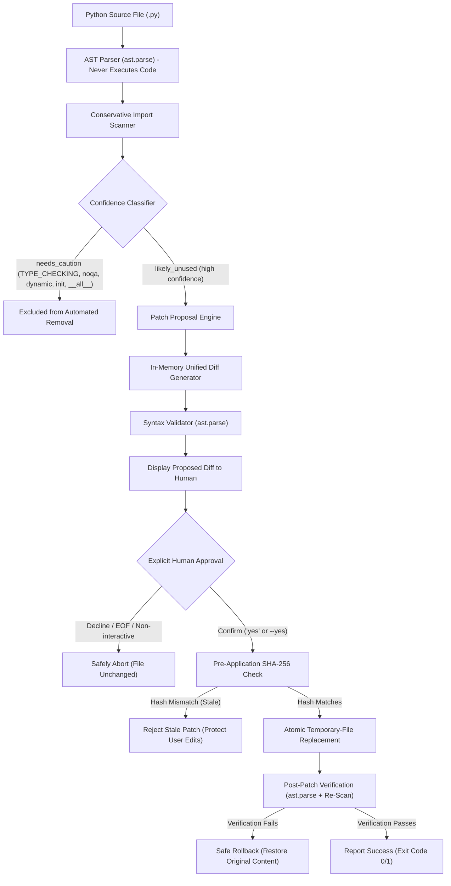

# MinionPatch

> **A conservative unused-import detection and safe, human-approved code fix CLI tool for Python, integrating OpenMinion.**
> Built for Cortensor Hackathon #5.

---

## Architecture Overview



---

## Safety Guarantees

1. **Zero Execution of Target Files**: MinionPatch **never executes** the target file. Scanning, diff generation, and verification are strictly AST-based.
2. **Explicit Human Confirmation Required**: Files are never modified automatically without explicit approval (e.g. typing `yes` or explicitly passing `--yes`).
3. **Conservative Removal Policy**: Only high-confidence (`likely_unused`) findings are eligible for patch proposals. Any finding classified as `needs_caution` is strictly excluded from automated patches.
4. **Stale Proposal Rejection**: Target file SHA-256 hashes are verified immediately prior to replacement. If the file was edited externally after proposal generation, the patch is aborted with exit code `2`.
5. **Atomic Replacement & Verification**: Proposed patches are written to a temporary file in the target directory, pre-validated with `ast.parse()`, atomically swapped with `os.replace()`, and rescanned.
6. **Automatic Rollback**: If post-patch verification fails (syntax error or unintended import removal), MinionPatch automatically restores the original file content.
7. **Race Condition Transparency**: In standard OS filesystems, an external write occurring during the microsecond between hash verification and atomic file replacement cannot be prevented without OS-level kernel file locking. MinionPatch minimizes this race window by preparing and pre-validating the temporary replacement file prior to the final hash check.

---

## Capability Status Matrix

| Capability | Status | Description |
| :--- | :--- | :--- |
| **AST Static Import Scanner** | `LOCALLY TESTED` | 100% offline, conservative unused import detection. |
| **Patch Proposal & Diffing** | `LOCALLY TESTED` | Unified diff generation without touching source files. |
| **Multi-Import Line Rewriting** | `LOCALLY TESTED` | E.g. `import os, sys` removes `os` while preserving `sys`. |
| **Cautionary Import Protection** | `LOCALLY TESTED` | `needs_caution` imports are never removed automatically. |
| **Human Approval / Rejection** | `LOCALLY TESTED` | Explicit `"yes"` required; refusal leaves files byte-identical. |
| **Stale Proposal Rejection** | `LOCALLY TESTED` | Aborts if SHA-256 hash changed since proposal generation. |
| **Atomic Replace & Rollback** | `LOCALLY TESTED` | Writes via temp file; rolls back if post-scan fails. |
| **OpenMinion Local Tool Registry** | `LOCALLY TESTED` | `@tool` registration and runtime dispatch verified offline. |
| **Deterministic Explanations** | `LOCALLY TESTED` | Rule-based explanations available 100% offline. |
| **Echo / Demo-Mode Diagnosis** | `LOCALLY TESTED` | Correctly diagnoses Echo mock provider; no fake AI claims. |
| **Real Model-Backed Tool Execution** | `NOT VERIFIED (CREDENTIALS)` | Requires active cloud API key (e.g. Anthropic, OpenAI). |
| **Cortensor Local Endpoint** | `NOT VERIFIED (ENDPOINT)` | Endpoint at `127.0.0.1:8080` was unreachable during local testing. |

---

## Installation & Setup

### Requirements
* Python 3.10+ (tested on Python 3.14.2 on Windows)
* Windows PowerShell or Linux terminal

### PowerShell Setup Commands

```powershell
# Navigate to the workspace
cd C:\Users\Lenovo\Documents\MINION--PATCH

# Activate virtual environment
..\MinionPatch\.venv\Scripts\Activate.ps1

# Install in editable mode
pip install -e .
```

---

## CLI Reference & Reproducible Demo

### 1. Offline Scanning

```powershell
minionpatch scan examples/sample_unused_imports.py
```
**Exit Code**: `1` (findings present)  
**Output**:
```text
Scanned examples\sample_unused_imports.py: 4 import name(s), 3 finding(s).
  line 1: [LIKELY UNUSED] import os  ->  os
      `os` is never referenced in this file. Removing it is probably safe, but module import side effects cannot be ruled out statically.
  line 2: [LIKELY UNUSED] import numpy as np  ->  np
      `np` is never referenced in this file. Removing it is probably safe, but module import side effects cannot be ruled out statically.
  line 3: [LIKELY UNUSED] from typing import Optional  ->  Optional
      `Optional` is never referenced in this file. Removing it is probably safe, but module import side effects cannot be ruled out statically.
```
*(Notice `math` is used by `math.sqrt()` and is correctly NOT flagged).*

Scanning a clean file:
```powershell
minionpatch scan examples/sample_clean.py
```
**Exit Code**: `0` (clean, 0 findings)

Machine-readable JSON:
```powershell
minionpatch scan examples/sample_unused_imports.py --json
```

---

### 2. Explanations (Deterministic vs. AI)

#### Offline Deterministic Explanation (Default)
```powershell
minionpatch explain examples/sample_unused_imports.py
```
Outputs rule-based AST explanations without touching any network or AI provider.

#### AI Explanation Mode
```powershell
minionpatch explain examples/sample_unused_imports.py --ai
```
* If OpenMinion has an active provider configured, queries the LLM for context.
* If OpenMinion is in demo mode (`provider = "echo"`) or no live provider is reachable, MinionPatch safely outputs:
  ```text
  [NON-AI DETERMINISTIC FALLBACK] Line 1: `import os`
    Bound name: `os` (confidence: likely_unused)
    Reason: `os` is never referenced in this file...
    Notice: Live AI provider is unavailable (OpenMinion is configured in demo mode with provider 'echo'). Falling back to deterministic rule-based analysis.
  ```

---

### 3. Patching Workflow

#### Dry Run / Proposal Mode (Safe, Does Not Modify File)
```powershell
minionpatch patch examples/sample_unused_imports.py --dry-run
```
Outputs the proposed unified diff:
```diff
--- a/examples\sample_unused_imports.py
+++ b/examples\sample_unused_imports.py
@@ -1,6 +1,3 @@
-import os
-import numpy as np
-from typing import Optional
 import math
 
 print(math.sqrt(25))
```

#### Interactive Patching (Requires Explicit Confirmation)
```powershell
minionpatch patch temp_copy.py
```
Displays proposed changes and asks:
```text
Apply this patch? Type 'yes' to confirm: 
```
* Typing `yes`: Applies patch, validates AST, rescans, and reports verification.
* Typing anything else (or running in non-interactive environment): Cancels immediately without modifying the file.

#### Automated Confirmation Mode
```powershell
minionpatch patch temp_copy.py --yes
```

---

## OpenMinion Integration & Diagnostic Feedback

Run the deterministic OpenMinion diagnostic:
```powershell
python test_agent.py
```

### Observed OpenMinion Behavior & Actionable SDK Feedback
1. **Echo Provider Behavior**: In `.openminion/agents.json`, setting `provider: "echo"` and `demo_mode: true` activates an echo mock that simply returns prompt strings. It does not parse tool specifications or dispatch tool calls, even when `forced_tools` is passed to `Agent`. MinionPatch explicitly detects this mode and explains it to users rather than claiming AI tool calling succeeded.
2. **Tool Handler Signature**: When registering a tool via `@tool`, OpenMinion creates a `ToolSpec` with an `args_model` (Pydantic model) and a `handler`. To invoke the tool handler through the registry, the caller must instantiate the args model (`spec.handler(spec.args_model())`). Calling `spec.handler()` without arguments raises a `TypeError` in the SDK's wrapper.
3. **Deterministic Verification**: MinionPatch verifies tool registration and dispatch through OpenMinion's `ToolRegistry` directly in Python without requiring network or paid API credentials.

### How to Configure a Real Model or Cortensor Node
To enable live model-driven execution:
1. **Cloud Providers** (Anthropic, OpenAI, Cerebras, Groq, OpenRouter):
   ```powershell
   $env:ANTHROPIC_API_KEY = "your-api-key"
   ```
   In `.openminion/agents.json`: set `"provider": "anthropic"` and `"demo_mode": false`.
2. **Local Cortensor Node**:
   * Start your Cortensor local inference node on `http://127.0.0.1:8080`.
   * Set `$env:CORTENSOR_API_KEY` if authentication is configured.
   * In `.openminion/agents.json`: set `"provider": "cortensor"` and `"demo_mode": false`.

---

## Running the Test Suite

```powershell
python -m pytest -v
```

**Test Suite Results**:
* `59 passed, 1 skipped` (Windows)
* **Skipped Test**: `tests/test_scanner.py::test_unreadable_file` is skipped on Windows because `chmod 0` permissions do not reliably revoke read access from the file owner on Windows NTFS. On POSIX/Linux, all 60 tests pass.
