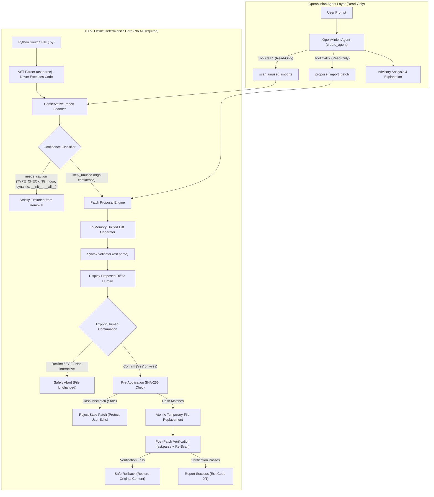

# MinionPatch

> **A conservative, AST-based unused-import detector and safe, human-approved patch engine for Python, integrating OpenMinion.**
> Built for Cortensor Hackathon #5.

---

## Overview

Dead and unused imports cause code clutter, unnecessary dependencies, and slower startup times. However, automatically stripping imports with a blunt regex or aggressive linter can break Python programs because:
1. Some modules run critical initialization logic upon import (side-effect imports).
2. Type annotations (especially in string quotes or guarded under `if TYPE_CHECKING:`) might look unused to basic scanners.
3. Package re-exports in `__init__.py` or dynamic imports (`__import__`, `importlib`) must be preserved.

**MinionPatch solves this safely**:
* **100% Deterministic Core**: Static analysis via Python's standard `ast` module. The target Python file is **never executed**.
* **Conservative Classification**: Distinguishes high-confidence candidates (`likely_unused`) from ambiguous cases (`needs_caution`). Cautionary imports are **never removed automatically**.
* **Human-in-the-Loop Guardrail**: Patches require explicit human confirmation. The AI agent operates in **read-only mode** and cannot modify files on disk.
* **Atomic Replacement & Verification**: Pre-validates syntax, pre-checks SHA-256 hashes against stale concurrent edits, writes through a temporary file, rescans post-patch, and **automatically rolls back** if syntax or imports break.
* **OpenMinion 0.1 SDK Integration**: Exposes read-only `@tool` functions to OpenMinion agents for automated scanning and patch proposals.

---

## Architectural Separation of Concerns

MinionPatch strictly isolates its deterministic safety engine from AI reasoning:



---

## Three Distinct Modes of Operation

| Layer / Mode | Environment & Providers | Internet Required? | File Modification? | Description |
| :--- | :--- | :--- | :--- | :--- |
| **1. Deterministic Core** | Local Python runtime (`ast`, `hashlib`, `difflib`) | **No (100% Offline)** | Yes, **only** with explicit human confirmation (`yes` / `--yes`) | The authoritative engine for scanning, generating diffs, atomic writing, and rollback verification. |
| **2. Local Ollama Agent** | OpenMinion SDK + local Ollama (`llama3.2:3b` at `127.0.0.1:11434`) | **No (Local Only)** | **No (Read-Only)** | An inspectable AI agent using read-only MinionPatch tools to review code and propose patches. |
| **3. Hosted Cortensor Portal** | OpenMinion SDK + Cortensor API Gateway (`api.cortensor.app/v1`) | Yes (when configured) | **No (Read-Only)** | Optional hosted inference path. Configurable via `CORTENSOR_API_KEY` and `CORTENSOR_MODEL` (defaults to `gemma4`). *Currently on waitlist; awaiting active Portal key and confirmation of the exact model slug.* |

### Verification Status Matrix

| Component / Workflow | Target / Provider | Status | Verification Evidence |
| :--- | :--- | :---: | :--- |
| **Deterministic Core & Safety Engine** | Python 3.14 (`ast`, `hashlib`, `difflib`) | **Locally Verified** | 84 passed, 1 skipped via `pytest -v` (100% offline, zero network access) |
| **OpenMinion Offline Runtime & Tools** | OpenMinion `ToolRegistry` (`0.1.1`) | **Locally Verified** | Tool registration and offline dispatch verified via `test_agent.py --offline` |
| **Local Ollama Model-Driven Workflow** | Ollama (`llama3.2:3b` on `127.0.0.1:11434`) | **Locally Verified** | Verified live via single-turn diagnostic (`test_agent.py`) and 5-step demo (`test_agent.py --demo -y`) |
| **Hosted Cortensor Portal** | Cortensor API Gateway (`api.cortensor.app/v1`) | **Pending Access** | Safe pre-flight script (`test_cortensor.py`) exits code 1 if key is unset; live portal testing pending waitlist access |

---

## Safety Guarantees

1. **Zero Execution of Target Files**: MinionPatch **never executes** the target file. Scanning, diff generation, and verification are strictly AST-based.
2. **Explicit Human Confirmation Required**: Files are never modified automatically without explicit approval (e.g. typing `yes` or passing `--yes`).
3. **No File-Modifying Tools Exposed to AI**: The OpenMinion tools (`scan_unused_imports`, `propose_import_patch`) are strictly read-only. Patch application is kept exclusively within human CLI control to prevent accidental or hallucinated file edits.
4. **Conservative Removal Policy**: Only high-confidence (`likely_unused`) findings are eligible for patch proposals. Any finding classified as `needs_caution` is strictly excluded from automated patches.
5. **Stale Proposal Rejection**: Target file SHA-256 hashes are verified immediately prior to replacement. If the file was edited externally after proposal generation, the patch is aborted with exit code `2`.
6. **Atomic Replacement & Verification**: Proposed patches are written to a temporary file (`.minionpatch_tmp_*.py`), pre-validated with `ast.parse()`, atomically swapped with `os.replace()`, and rescanned.
7. **Automatic Rollback**: If post-patch verification fails (syntax error or unintended import removal), MinionPatch automatically restores the original file content.
8. **Credential Protection**: All API keys are loaded strictly from environment variables. Secrets are masked in error logs and never logged, hardcoded, or committed.

---

## Installation & Setup

### Requirements
* Python 3.10+ (tested on Python 3.14 on Windows)
* Windows PowerShell or Linux terminal
* (Optional for local AI) [Ollama](https://ollama.ai) installed with `llama3.2:3b`

### PowerShell Setup Commands

```powershell
# Navigate to the workspace
cd C:\Users\Lenovo\Documents\MINION--PATCH

# Activate virtual environment
.\.venv\Scripts\Activate.ps1

# Install in editable mode
pip install -e .
```

---

## CLI Reference & Usage

### 1. Scanning a File (Offline, Deterministic)

Scans a file and reports unused imports along with confidence levels:

```powershell
minionpatch scan examples/sample_unused_imports.py
```
**Exit Code**: `1` (findings detected)
**Output**:
```text
Scanned examples\sample_unused_imports.py: 4 import name(s), 3 finding(s).
  line 1: [LIKELY UNUSED] import os  ->  os
      `os` is never referenced in this file. Removing it is probably safe, but module import side effects cannot be ruled out statically.
  line 2: [LIKELY UNUSED] import numpy as np  ->  np
      `np` is never referenced in this file. Removing it is probably safe, but module import side effects cannot be ruled out statically.
  line 3: [LIKELY UNUSED] from typing import Optional  ->  Optional
      `Optional` is never referenced in this file. Removing it is probably safe, but module import side effects cannot be ruled out statically.
```
*(Notice `math` is used by `math.sqrt()` and is correctly not flagged).*

Scanning a clean file:
```powershell
minionpatch scan examples/sample_clean.py
```
**Exit Code**: `0` (clean, 0 findings)

Machine-readable JSON output:
```powershell
minionpatch scan examples/sample_unused_imports.py --json
```

---

### 2. Explaining Findings

#### Offline Deterministic Explanation (Default)
Outputs rule-based AST explanations without touching any network or AI provider:
```powershell
minionpatch explain examples/sample_unused_imports.py
```

#### AI Explanation Mode (Optional)
Uses the active OpenMinion provider (e.g. local Ollama `llama3.2:3b`) for conversational code quality advice:
```powershell
minionpatch explain examples/sample_unused_imports.py --ai
```
*If the AI provider is unavailable or offline, it safely falls back to the deterministic AST explanation without crashing.*

---

### 3. Patching Workflow (Human Approval Required)

#### Dry Run / Proposal Mode (Safe, Does Not Modify File)
Inspect the proposed unified diff in memory:
```powershell
minionpatch patch examples/sample_unused_imports.py --dry-run
```
**Output**:
```diff
--- a/examples\sample_unused_imports.py
+++ b/examples\sample_unused_imports.py
@@ -1,6 +1,3 @@
-import os
-import numpy as np
-from typing import Optional
 import math

 print(math.sqrt(25))

[DRY RUN / PROPOSAL ONLY] No changes were made to the file.
```

#### Interactive Patch Application
Displays the diff and prompts for explicit confirmation:
```powershell
minionpatch patch target_file.py
```
Prompt:
```text
Apply this patch? Type 'yes' to confirm:
```
* Typing `yes`: Verifies hash, applies patch via temp file, rescans, verifies AST syntax, and commits changes.
* Typing anything else (or non-interactive shell without `--yes`): Aborts safely, leaving the file 100% byte-identical.

#### Automated Human Approval
For CI/CD or scripted environments where confirmation is given explicitly upfront:
```powershell
minionpatch patch target_file.py --yes
```

---

## OpenMinion SDK Integration

MinionPatch integrates with the **OpenMinion 0.1 Python SDK** (`openminion==0.1.1`).

### Available Read-Only Tools (`minionpatch.tools`)

| Tool Function | Inputs | Returns | Behavior |
| :--- | :--- | :--- | :--- |
| `scan_unused_imports` | `file_path: str` | JSON string | Pure AST analysis. Returns detected unused imports, line numbers, and confidence ratings (`likely_unused` vs `needs_caution`). Never executes code. |
| `propose_import_patch` | `file_path: str` | JSON string | Generates an in-memory unified diff for `likely_unused` candidates. Excludes cautionary findings. Never modifies the file on disk. |

> [!IMPORTANT]
> **Why No Apply Tool?** To enforce strict human safety, `apply_patch` is deliberately not exposed as an agent tool. AI models can hallucinate or be prompted to confirm unintended actions. Code modifications must remain human-supervised via `minionpatch patch <file>`.

### Running an OpenMinion Agent in Python

You can initialize an agent equipped with MinionPatch tools in three lines of Python:

```python
from minionpatch import create_agent

with create_agent() as agent:
    result = agent.run("Scan examples/sample_unused_imports.py and propose a patch.")
    print(result.text)
```

The agent uses OpenMinion's `ToolRegistry` to invoke `scan_unused_imports` and `propose_import_patch`, reviewing the results and advising the user.

---

## Building Blocks Tested

During the development and verification of MinionPatch with OpenMinion 0.1 (`openminion==0.1.1`), the following core building blocks were implemented and evaluated:

### 1. OpenMinion `@tool` Registration & Argument Schema Generation
* **Implementation:** The read-only tools `scan_unused_imports` and `propose_import_patch` in `src/minionpatch/tools.py` are decorated with `@tool`.
* **Observed Behavior:** OpenMinion inspects function type hints and docstrings to automatically generate a Pydantic argument model (`spec.args_model`) and standard JSON schema (`spec.args_model.model_json_schema()`).
* **Validation:** Verified both by direct invocation (`test_openminion_tool_decorator_direct_call`) and by schema extraction for LLM tool injection (`test_openminion_tool_registration_in_runtime`).

### 2. Agent & Runtime Lifecycle with Registered Tool Execution
* **Implementation:** Agents are initialized via context manager (`with Agent(...) as agent:`).
* **Observed Behavior:** The agent ensures a runtime environment (`agent._ensure_runtime()`) and dynamically registers tools into `runtime.tools` via `agent._register_tools_for_run(runtime)`.
* **Execution:** Tool handlers execute deterministically in offline environments through `spec.handler(args_instance)` and clean up via `agent._unregister_tools()`. This allows 100% offline unit and integration testing without network calls or API keys.

### 3. Live Model-Driven Tool Calling (Local Ollama with `llama3.2:3b`)
* **Implementation:** In `test_agent.py`, tool specifications are converted to `LLMToolSpec` and provided to OpenMinion's LLM client (`client.complete(messages, tools)`).
* **Observed Behavior:** The local Ollama model (`llama3.2:3b`) receives the user prompt and tool definitions, evaluates the request, and generates a structured tool call (e.g. `scan_unused_imports(file_path="examples/sample_unused_imports.py")`) rather than raw text.
* **Execution:** The runtime validates the tool call, maps arguments, executes the local handler, and returns real AST scan findings.

### 4. Returning Tool Results for Final Model Synthesis
* **Implementation:** Following local handler execution, the structured result is packaged into a `Message` with `role="tool"`, referencing `tool_call_id`, `name`, and `content`.
* **Observed Behavior:** In the second inference pass, Ollama receives the full conversational context (user prompt + assistant tool call + tool response) and synthesizes a natural-language advisory summary for the developer.

### 5. What Failed, Limitations Encountered & Resolutions
* **Echo Mock Provider Tool Inability:**
  * *Limitation:* OpenMinion's built-in `echo` mock provider echoes raw input strings without parsing tool specifications or invoking registered tools.
  * *Handling:* Built deterministic offline verification directly against OpenMinion's `ToolRegistry` handler pipeline in `test_agent.py` and `tests/test_tools.py`, enabling reliable CI/CD verification without requiring an external LLM server.
* **Small Model Argument Malformation:**
  * *Limitation:* Compact local LLMs (`llama3.2:3b`) occasionally produce malformed JSON or omit expected dictionary keys under complex instructions.
  * *Handling:* Implemented defensive argument validation using `spec.args_model(**arguments)` with explicit error traps, falling back to descriptive diagnostic messages if parameters fail validation.
* **Service Availability Probing:**
  * *Limitation:* If Ollama is not running on `127.0.0.1:11434`, connection attempts could hang or raise unhandled socket exceptions.
  * *Handling:* Implemented fast pre-flight connection probing in `check_live_provider_status()` (1-second socket probe). If unreachable, it warns the user and provides provider-specific setup instructions without crashing.
* **Cortensor Portal Waitlist Status:**
  * *Limitation:* Hosted Cortensor Portal access is currently waitlisted; an active Portal API key and confirmed model slug are pending.
  * *Handling:* Created a safe pre-flight script (`test_cortensor.py`) that exits safely with code `1` if `$env:CORTENSOR_API_KEY` is unset, making zero unauthorized network calls.

### 6. Intentional Exclusion of Patch Application from Agent Tools
* **Design Decision:** The AI agent is strictly provided with read-only tools (`scan_unused_imports` and `propose_import_patch`). The patch application function (`apply_patch`) is **deliberately not exposed** to OpenMinion.
* **Rationale:** AI models can hallucinate, produce destructive diffs, or be manipulated via prompt injection into confirming unintended file changes. Keeping patch application exclusively within human hands via the CLI (`minionpatch patch <file>`) guarantees that no file modification can occur without human confirmation.

---

## What We Learned (Feedback for OpenMinion SDK)

Based on building MinionPatch on top of OpenMinion 0.1, here is actionable feedback for the OpenMinion development team:

1. **Better Offline Mock Support for Tool Calling (Recommendation)**
   * *Observation:* The current `echo` provider does not simulate tool calls or trigger tool execution. This makes it challenging to test multi-turn agent workflows and tool dispatching in headless CI environments without running a live model like Ollama.
   * *Recommendation:* Provide a mock tool-dispatching provider (or a `--mock-tools` flag) that can accept predefined tool responses or automatically dispatch registered tool handlers during unit tests.

2. **Clearer Errors for Invalid Tool Arguments and Execution Failures (Recommendation)**
   * *Observation:* When a local LLM returns parameters that do not match the Pydantic argument model, debugging raw validation errors inside the agent runtime can be cumbersome.
   * *Recommendation:* Expose distinct, typed exception classes (e.g. `ToolArgumentValidationError` and `ToolExecutionError`) so developers can easily differentiate between model hallucination/schema mismatches and runtime handler exceptions.

3. **Public API for Tool Registration and Unregistration Lifecycle (Observation & Recommendation)**
   * *Observation:* Dynamically managing tools on an existing runtime currently relies on private methods (`agent._register_tools_for_run` and `agent._unregister_tools`).
   * *Recommendation:* Expose official public methods on the runtime (e.g., `runtime.register_tool(tool)` and `runtime.unregister_tool(tool_name)`) to facilitate dynamic tool management for long-running agents.

4. **Cross-Platform File-Path Handling Guidelines (Observation & Recommendation)**
   * *Observation:* On Windows, file paths passed by users or generated by models often mix backslashes (`\`) and forward slashes (`/`). This can lead to subtle discrepancies in diff headers and file lookups.
   * *Recommendation:* Encourage path normalization (e.g., via `pathlib.Path`) in the SDK documentation and consider providing built-in path-coercion helpers for tool schemas that accept file system targets.

---

## AI Provider Configuration

Provider settings are stored in `.openminion/agents.json`.

### 1. Local Ollama (Active & Tested Setup)
MinionPatch is pre-configured to use local Ollama with `llama3.2:3b`:
1. Start Ollama locally:
   ```powershell
   ollama run llama3.2:3b
   ```
2. In `.openminion/agents.json`, verify:
   ```json
   "agents": {
     "openminion": {
       "provider": "ollama"
     }
   },
   "providers": {
     "ollama": {
       "base_url": "http://127.0.0.1:11434",
       "model": "llama3.2:3b"
     }
   }
   ```
3. Run the OpenMinion diagnostic or full demo using the virtual environment:
   ```powershell
   # Offline deterministic verification (no LLM or network needed):
   .\.venv\Scripts\python.exe test_agent.py --offline

   # Live single-turn model health diagnostic (requires Ollama running):
   .\.venv\Scripts\python.exe test_agent.py

   # Full 5-step model-driven workflow demo (requires Ollama running):
   .\.venv\Scripts\python.exe test_agent.py --demo
   ```

### 2. Hosted Cortensor Portal (Optional / Hackathon Integration)
The Cortensor Portal provides an OpenAI-compatible hosted API gateway at `https://api.cortensor.app/v1`.

* **Model Specification:** The hackathon community requested **Gemma 4** as an optional hosted model target (not OSS20B).
* **Environment Configuration:**
  ```powershell
  # Set your Portal API key
  $env:CORTENSOR_API_KEY = "your-actual-portal-api-key"

  # Optional model override (defaults to 'gemma4')
  $env:CORTENSOR_MODEL = "gemma4"

  # Optional endpoint override (defaults to 'https://api.cortensor.app/v1')
  $env:CORTENSOR_API_URL = "https://api.cortensor.app/v1"
  ```
* **Pre-flight Test Script:**
  ```powershell
  .\.venv\Scripts\python.exe test_cortensor.py
  ```
  * *If `CORTENSOR_API_KEY` is not set:* The script exits safely with code `1`, making **zero** network requests and redacting all secrets.
  * *Status Note:* Hosted Cortensor Portal inference has not yet been performed because portal access is currently on the waitlist. A valid Portal API key and confirmation of the exact model slug (e.g. `gemma4`, `gemma-4`, etc.) from the portal team are still required before live testing.

---

## Verification & Testing

MinionPatch provides a comprehensive test and diagnostic suite across its deterministic core and OpenMinion integration layers.

### Verification Command Reference

| Command | Live Model Required? | API Key Required? | Purpose & Expected Behavior |
| :--- | :---: | :---: | :--- |
| `.\.venv\Scripts\python.exe -m pytest -v` | **No** (100% Offline) | **None** | Runs the full 85-test suite (84 passed, 1 skipped on Windows NTFS). Tests scanner, patcher, CLI, safety rollback, and OpenMinion tools. |
| `.\.venv\Scripts\python.exe test_agent.py --offline` | **No** (100% Offline) | **None** | Verifies direct tool execution, OpenMinion `ToolRegistry` registration, and offline handler dispatch (Steps 1–3). Exits code 0 without live model calls. |
| `.\.venv\Scripts\python.exe test_agent.py` | **Yes** (Local Ollama) | **None** (Local) | Single-turn live health diagnostic (Steps 1–4). Sends prompt with `check_project` tool definition to Ollama (`llama3.2:3b`), validates tool execution, and synthesizes response. |
| `.\.venv\Scripts\python.exe test_agent.py --demo` | **Yes** (Local Ollama) | **None** (Local) | Full 5-step model-driven workflow demo on `examples/sample_unused_imports.py` (scan -> findings -> proposal -> SHA-256 verification -> human gate -> temp-copy patch). Pass `-y` for auto-approval. |
| `.\.venv\Scripts\python.exe test_cortensor.py` | **Yes** (Cortensor Portal) | **$env:CORTENSOR_API_KEY** | Safe pre-flight validation script for Cortensor Portal integration. Checks for `$env:CORTENSOR_API_KEY`; if unset, exits safely with code 1 making zero network calls. |

### Running the Commands in Windows PowerShell

```powershell
# Activate virtual environment
.\.venv\Scripts\Activate.ps1

# 1. Run the offline test suite (84 passed, 1 skipped)
.\.venv\Scripts\python.exe -m pytest -v

# 2. Run the OpenMinion offline tool registration diagnostic (Steps 1-3)
.\.venv\Scripts\python.exe test_agent.py --offline

# 3. Run the live single-turn model health diagnostic (requires Ollama running)
.\.venv\Scripts\python.exe test_agent.py

# 4. Run the full 5-step model-driven workflow demo (requires Ollama running)
.\.venv\Scripts\python.exe test_agent.py --demo

# 5. Run the safe Cortensor Portal pre-flight script (blocks safely if key unset)
.\.venv\Scripts\python.exe test_cortensor.py
```

**Test Suite Results**:
* `84 passed, 1 skipped` in ~7 seconds.
* **Skipped Test**: `tests/test_scanner.py::test_unreadable_file` is skipped on Windows NTFS because `chmod 0` does not revoke read access from the file owner on Windows. On POSIX/Linux, all 85 tests pass.

---

## Demo Video

* **Video Walkthrough URL:** `[DEMO VIDEO LINK - PLACEHOLDER]` *(To be updated upon video recording upload)*
* **Key Workflow Steps Demonstrated:**
  1. **Offline Tool Registration:** Running `test_agent.py --offline` to verify that OpenMinion registers `check_project`, `scan_unused_imports`, and `propose_import_patch` deterministically.
  2. **Model-Driven AST Scanning:** Prompting local Ollama (`llama3.2:3b`) through OpenMinion. The model autonomously invokes `scan_unused_imports` on `examples/sample_unused_imports.py` and reports genuine AST findings.
  3. **In-Memory Diff Proposal:** Prompting the model to invoke `propose_import_patch`. The tool computes a unified diff in memory without modifying the file on disk.
  4. **Original File Integrity Verification:** Demonstrating that the target file's SHA-256 hash remains 100% byte-identical before, during, and after proposal generation.
  5. **Explicit Human Approval Gate:** Showing the interactive human gate (`[y/N]`), demonstrating safe decline without side-effects, and approving patch application.
  6. **Temporary-Copy Patch Application & Validation:** Verifying atomic patching against an isolated temporary copy (`NamedTemporaryFile`), confirming valid Python syntax and 0 remaining unused imports, and cleaning up temporary files.

---

## Project Structure

```text
MINION--PATCH/
├── .openminion/
│   └── agents.json          # OpenMinion provider configuration (local Ollama)
├── examples/
│   ├── sample_clean.py      # Reference clean Python file
│   └── sample_unused_imports.py # Sample file with intentional unused imports
├── src/
│   └── minionpatch/
│       ├── __init__.py      # Package public API exports
│       ├── agent.py         # OpenMinion Agent integration (create_agent)
│       ├── cli.py           # Command-line interface (scan, explain, patch)
│       ├── explainer.py     # Deterministic & AI explanation logic
│       ├── models.py        # Shared data structures (ScanResult, PatchProposal)
│       ├── patcher.py       # Safe diff generator, atomic replace & rollback
│       ├── scanner.py       # Deterministic AST unused-import scanner
│       └── tools.py         # Read-only OpenMinion @tool definitions
├── tests/
│   ├── test_cli.py          # CLI integration and argument tests
│   ├── test_openminion_integration.py # OpenMinion runtime & provider tests
│   ├── test_patcher.py      # Patcher, AST validation, and rollback tests
│   ├── test_scanner.py      # Scanner AST analysis tests
│   └── test_tools.py        # Read-only OpenMinion tool tests
├── test_agent.py            # OpenMinion tool registration diagnostic
├── test_cortensor.py        # Safe Cortensor Portal pre-flight test
└── pyproject.toml           # Build configuration & dependencies
```
